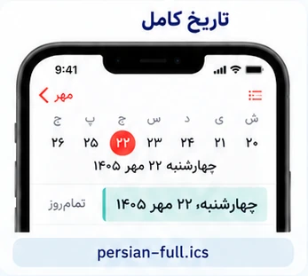
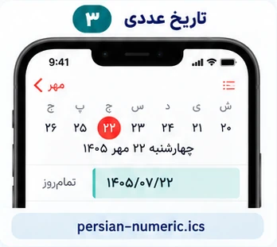
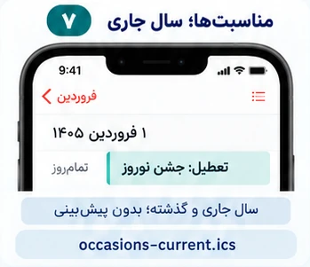
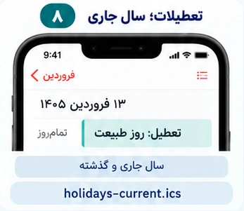
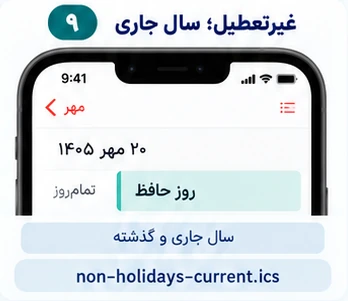
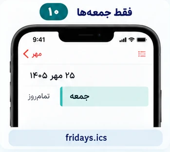
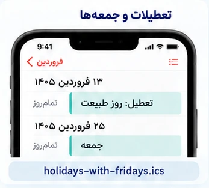

# تقویم شمسی برای آیفون

تاریخ فارسی، تعطیلات و مناسبت‌ها در Calendar آیفون؛ با لینک ثابت و به‌روزرسانی خودکار.

## شروع سریع

۱. از جدول، حالت دلخواه را انتخاب و **آدرس لینک اشتراک را کپی کن**.

۲. در آیفون برو به:

`Calendar → Calendars → Add Calendar → Add Subscription Calendar`

۳. آدرس را وارد و اشتراک را ذخیره کن. رنگ هر تقویم را می‌توانی خودت انتخاب کنی.

## همهٔ حالت‌های اشتراک

**فقط تاریخ فارسی:** «تاریخ کوتاه». **تاریخ و تعطیلات با دو رنگ:** «تاریخ کوتاه» + «فقط تعطیلات». **همه‌چیز با یک لینک:** «تاریخ و مناسبت‌ها».

| حالت | لینک اشتراک | نمونه در آیفون |
|---|---|---|
| تاریخ کوتاه؛ مثل ۲۲ مهر | [دریافت / اشتراک](https://raw.githubusercontent.com/hossbit/persian_calender/main/feeds/persian.ics) |  |
| فقط تعطیلات مناسبتی؛ شامل پیش‌بینی آینده | [دریافت / اشتراک](https://raw.githubusercontent.com/hossbit/persian_calender/main/feeds/holidays.ics) |  |
| تاریخ کوتاه و همهٔ مناسبت‌ها در یک اشتراک | [دریافت / اشتراک](https://raw.githubusercontent.com/hossbit/persian_calender/main/feeds/combined.ics) |  |
| تاریخ کامل؛ روز هفته، روز، ماه و سال | [دریافت / اشتراک](https://raw.githubusercontent.com/hossbit/persian_calender/main/feeds/persian-full.ics) |  |
| تاریخ عددی فارسی؛ مثل ۱۴۰۵/۰۷/۲۲ | [دریافت / اشتراک](https://raw.githubusercontent.com/hossbit/persian_calender/main/feeds/persian-numeric.ics) |  |
| همهٔ مناسبت‌ها و تعطیلات؛ شامل پیش‌بینی آینده | [دریافت / اشتراک](https://raw.githubusercontent.com/hossbit/persian_calender/main/feeds/occasions.ics) |  |
| فقط مناسبت‌های غیرتعطیل؛ شامل پیش‌بینی آینده | [دریافت / اشتراک](https://raw.githubusercontent.com/hossbit/persian_calender/main/feeds/non-holidays.ics) |  |
| مناسبت‌ها و تعطیلات؛ فقط سال جاری و گذشته | [دریافت / اشتراک](https://raw.githubusercontent.com/hossbit/persian_calender/main/feeds/occasions-current.ics) |  |
| فقط تعطیلات مناسبتی؛ سال جاری و گذشته | [دریافت / اشتراک](https://raw.githubusercontent.com/hossbit/persian_calender/main/feeds/holidays-current.ics) |  |
| مناسبت‌های غیرتعطیل؛ سال جاری و گذشته | [دریافت / اشتراک](https://raw.githubusercontent.com/hossbit/persian_calender/main/feeds/non-holidays-current.ics) |  |
| فقط جمعه‌ها | [دریافت / اشتراک](https://raw.githubusercontent.com/hossbit/persian_calender/main/feeds/fridays.ics) |  |
| تعطیلات مناسبتی به‌همراه جمعه‌ها؛ شامل پیش‌بینی آینده | [دریافت / اشتراک](https://raw.githubusercontent.com/hossbit/persian_calender/main/feeds/holidays-with-fridays.ics) |  |
| روز هفته و تاریخ کوتاه؛ مثل چهارشنبه، ۲۲ مهر | [دریافت / اشتراک](https://raw.githubusercontent.com/hossbit/persian_calender/main/feeds/persian-weekday.ics) |  |
| تاریخ عددی بدون سال؛ مثل ۰۷/۲۲ | [دریافت / اشتراک](https://raw.githubusercontent.com/hossbit/persian_calender/main/feeds/persian-numeric-short.ics) |  |
| تاریخ کوتاه و فقط تعطیلات در یک اشتراک | [دریافت / اشتراک](https://raw.githubusercontent.com/hossbit/persian_calender/main/feeds/dates-holidays.ics) |  |
| تاریخ کوتاه و مناسبت‌ها؛ بدون پیش‌بینی سال‌های آینده | [دریافت / اشتراک](https://raw.githubusercontent.com/hossbit/persian_calender/main/feeds/combined-current.ics) |  |

فقط حالت‌های لازم را اضافه کن؛ لینک‌های هم‌پوشان ممکن است رویداد تکراری نشان بدهند. نسخهٔ ترکیبی را همراه تاریخ کوتاه یا همهٔ مناسبت‌ها اضافه نکن.

تصاویر شبیه‌سازی‌اند. تاریخ‌ها به شکل رویداد تمام‌روز نمایش داده می‌شوند؛ چیدمان ماه‌های خود Calendar تغییر نمی‌کند. مناسبت‌های آینده با «پیش‌بینی» مشخص‌اند و پوشش آن‌ها به دادهٔ موجود منبع وابسته است.

[جزئیات فنی و منابع](TECHNICAL.md) · [راهنمای کامل حالت‌ها](SUBSCRIPTIONS.md)
