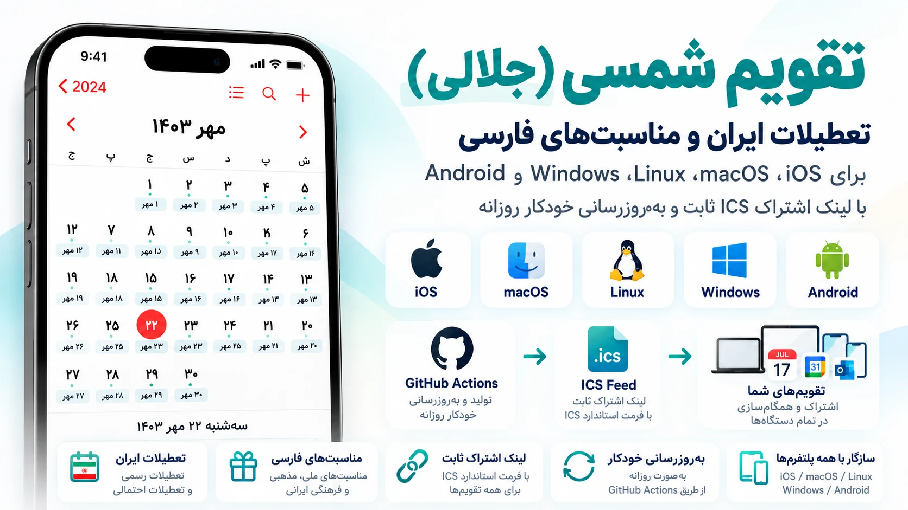

  
  
  
  
  

  
  
  
  
  

# تقویم شمسی چندسکویی | Persian Calendar (ICS)

تقویم شمسی (جلالی)، تعطیلات ایران و مناسبت‌های فارسی برای iOS، macOS، Linux، Windows و Android؛ با لینک اشتراک ICS ثابت و به‌روزرسانی خودکار روزانه.

Persian / Jalali / Shamsi ICS subscriptions for Apple Calendar, Thunderbird, Evolution, Google Calendar and Outlook on Linux, macOS, Windows, Android and iOS.

[راهنمای همهٔ سیستم‌عامل‌ها](PLATFORMS.md) · [English guide](README.en.md) · [انتخاب لینک اشتراک](#subscriptions)

تاریخ روزانه و جمعه‌ها: **۱۰ سال گذشته تا ۱۰ سال آینده**؛ بازه هر روز جلو می‌رود. مناسبت‌ها و تعطیلات مستقیماً از Time.ir دریافت می‌شوند و پوشش آن‌ها به دادهٔ موجود سایت وابسته است.

## استفاده در سیستم‌عامل‌های مختلف

همهٔ حالت‌ها از همان لینک HTTPS استفاده می‌کنند؛ روش افزودن اشتراک به برنامه بستگی دارد.

| دستگاه | برنامه | روش افزودن |
|---|---|---|
| آیفون / آیپد | Apple Calendar | دو مسیر زیر |
| مک | Apple Calendar | File → New Calendar Subscription |
| لینوکس / ویندوز / مک | Thunderbird | New Calendar → On the Network |
| لینوکس | Evolution | New Calendar → On the Web |
| ویندوز / مرورگر | Outlook | Add calendar → Subscribe from web |
| اندروید / مرورگر | Google Calendar | افزودن در نسخهٔ وب از From URL؛ سپس نمایش در گوشی |

[مراحل کامل نصب و همگام‌سازی برای هر سیستم‌عامل](PLATFORMS.md)

## شروع سریع در آیفون و آیپد

۱. از جدول، حالت دلخواه را انتخاب و **آدرس لینک اشتراک را کپی کن**.

۲. یکی از دو مسیر زیر را انتخاب کن:

**از داخل Calendar — در iOS 26 و جدیدتر:**

`Calendar → Calendars → Add Calendar → Add Subscription Calendar`

**از تنظیمات آیفون:**

`Settings → Apps → Calendar → Calendar Accounts → Add Account → Other → Add Subscribed Calendar`

۳. لینک را وارد کن و مراحل افزودن اشتراک را تا پایان ادامه بده. در روش Calendar ابتدا **Find** را بزن و در پایان **Done** را انتخاب کن. رنگ هر تقویم را می‌توانی خودت تغییر بدهی.

[راهنمای اپل: روش Calendar](https://support.apple.com/en-me/102301) · [راهنمای اپل: روش Settings](https://support.apple.com/en-ie/guide/iphone/ipha0d932e96/26/ios/26)

## همهٔ حالت‌های اشتراک

متن نمونه بالای هر تصویر آمده است؛ برای بزرگ‌نمایی، روی تصویر بزن.

**فقط تاریخ فارسی:** «تاریخ کوتاه». **تاریخ و تعطیلات با دو رنگ:** «تاریخ کوتاه» + «فقط تعطیلات». **همه‌چیز با یک لینک:** «تاریخ و مناسبت‌ها».

<h3>تاریخ روزانه</h3>
<table align="center">
<tbody>
<tr>
<td align="center" valign="middle"><strong>تاریخ کوتاه؛ مثل ۲۲ مهر</strong></td>
<td align="center" valign="middle"><strong>روز هفته و تاریخ کوتاه؛ مثل چهارشنبه، ۲۲ مهر</strong></td>
</tr>
<tr>
<td align="center" valign="middle">
۲۲ مهر
</td>
<td align="center" valign="middle">
چهارشنبه، ۲۲ مهر
</td>
</tr>
<tr>
<td align="center" valign="middle"><table align="center"><tbody><tr><td align="center" width="260"></td></tr></tbody></table></td>
<td align="center" valign="middle"><table align="center"><tbody><tr><td align="center" width="260"></td></tr></tbody></table></td>
</tr>
<tr>
<td align="center" valign="middle"><a href="https://raw.githubusercontent.com/hossbit/persian_calender/main/feeds/persian.ics"><strong>لینک اشتراک</strong></a></td>
<td align="center" valign="middle"><a href="https://raw.githubusercontent.com/hossbit/persian_calender/main/feeds/persian-weekday.ics"><strong>لینک اشتراک</strong></a></td>
</tr>
<tr>
<td align="center" valign="middle"><strong>تاریخ کامل؛ روز هفته، روز، ماه و سال</strong></td>
<td align="center" valign="middle"><strong>تاریخ عددی فارسی؛ مثل ۱۴۰۵/۰۷/۲۲</strong></td>
</tr>
<tr>
<td align="center" valign="middle">
چهارشنبه، ۲۲ مهر ۱۴۰۵
</td>
<td align="center" valign="middle">
۱۴۰۵/۰۷/۲۲
</td>
</tr>
<tr>
<td align="center" valign="middle"><table align="center"><tbody><tr><td align="center" width="260"></td></tr></tbody></table></td>
<td align="center" valign="middle"><table align="center"><tbody><tr><td align="center" width="260"></td></tr></tbody></table></td>
</tr>
<tr>
<td align="center" valign="middle"><a href="https://raw.githubusercontent.com/hossbit/persian_calender/main/feeds/persian-full.ics"><strong>لینک اشتراک</strong></a></td>
<td align="center" valign="middle"><a href="https://raw.githubusercontent.com/hossbit/persian_calender/main/feeds/persian-numeric.ics"><strong>لینک اشتراک</strong></a></td>
</tr>
<tr>
<td colspan="2" align="center" valign="middle"><strong>تاریخ عددی بدون سال؛ مثل ۰۷/۲۲</strong></td>
</tr>
<tr>
<td colspan="2" align="center" valign="middle">
۰۷/۲۲
</td>
</tr>
<tr>
<td colspan="2" align="center" valign="middle"><table align="center"><tbody><tr><td align="center" width="260"></td></tr></tbody></table></td>
</tr>
<tr>
<td colspan="2" align="center" valign="middle"><a href="https://raw.githubusercontent.com/hossbit/persian_calender/main/feeds/persian-numeric-short.ics"><strong>لینک اشتراک</strong></a></td>
</tr>
</tbody>
</table>

<h3>تعطیلات و مناسبت‌ها</h3>
<table align="center">
<tbody>
<tr>
<td align="center" valign="middle"><strong>فقط تعطیلات مناسبتی؛ شامل پیش‌بینی آینده</strong></td>
<td align="center" valign="middle"><strong>همهٔ مناسبت‌ها و تعطیلات؛ شامل پیش‌بینی آینده</strong></td>
</tr>
<tr>
<td align="center" valign="middle">
تعطیل: جشن نوروز
</td>
<td align="center" valign="middle">
تعطیل: جشن نوروز · پیش‌بینی: تعطیل: جشن نوروز
</td>
</tr>
<tr>
<td align="center" valign="middle"><table align="center"><tbody><tr><td align="center" width="260"></td></tr></tbody></table></td>
<td align="center" valign="middle"><table align="center"><tbody><tr><td align="center" width="260"></td></tr></tbody></table></td>
</tr>
<tr>
<td align="center" valign="middle"><a href="https://raw.githubusercontent.com/hossbit/persian_calender/main/feeds/holidays.ics"><strong>لینک اشتراک</strong></a></td>
<td align="center" valign="middle"><a href="https://raw.githubusercontent.com/hossbit/persian_calender/main/feeds/occasions.ics"><strong>لینک اشتراک</strong></a></td>
</tr>
<tr>
<td align="center" valign="middle"><strong>فقط مناسبت‌های غیرتعطیل؛ شامل پیش‌بینی آینده</strong></td>
<td align="center" valign="middle"><strong>فقط تعطیلات مناسبتی؛ سال جاری و گذشته</strong></td>
</tr>
<tr>
<td align="center" valign="middle">
آغاز سال تحصیلی
</td>
<td align="center" valign="middle">
تعطیل: روز طبیعت
</td>
</tr>
<tr>
<td align="center" valign="middle"><table align="center"><tbody><tr><td align="center" width="260"></td></tr></tbody></table></td>
<td align="center" valign="middle"><table align="center"><tbody><tr><td align="center" width="260"></td></tr></tbody></table></td>
</tr>
<tr>
<td align="center" valign="middle"><a href="https://raw.githubusercontent.com/hossbit/persian_calender/main/feeds/non-holidays.ics"><strong>لینک اشتراک</strong></a></td>
<td align="center" valign="middle"><a href="https://raw.githubusercontent.com/hossbit/persian_calender/main/feeds/holidays-current.ics"><strong>لینک اشتراک</strong></a></td>
</tr>
<tr>
<td align="center" valign="middle"><strong>مناسبت‌ها و تعطیلات؛ فقط سال جاری و گذشته</strong></td>
<td align="center" valign="middle"><strong>مناسبت‌های غیرتعطیل؛ سال جاری و گذشته</strong></td>
</tr>
<tr>
<td align="center" valign="middle">
تعطیل: جشن نوروز
</td>
<td align="center" valign="middle">
روز حافظ
</td>
</tr>
<tr>
<td align="center" valign="middle"><table align="center"><tbody><tr><td align="center" width="260"></td></tr></tbody></table></td>
<td align="center" valign="middle"><table align="center"><tbody><tr><td align="center" width="260"></td></tr></tbody></table></td>
</tr>
<tr>
<td align="center" valign="middle"><a href="https://raw.githubusercontent.com/hossbit/persian_calender/main/feeds/occasions-current.ics"><strong>لینک اشتراک</strong></a></td>
<td align="center" valign="middle"><a href="https://raw.githubusercontent.com/hossbit/persian_calender/main/feeds/non-holidays-current.ics"><strong>لینک اشتراک</strong></a></td>
</tr>
<tr>
<td align="center" valign="middle"><strong>فقط جمعه‌ها</strong></td>
<td align="center" valign="middle"><strong>تعطیلات مناسبتی به‌همراه جمعه‌ها؛ شامل پیش‌بینی آینده</strong></td>
</tr>
<tr>
<td align="center" valign="middle">
جمعه
</td>
<td align="center" valign="middle">
تعطیل: روز طبیعت · جمعه
</td>
</tr>
<tr>
<td align="center" valign="middle"><table align="center"><tbody><tr><td align="center" width="260"></td></tr></tbody></table></td>
<td align="center" valign="middle"><table align="center"><tbody><tr><td align="center" width="260"></td></tr></tbody></table></td>
</tr>
<tr>
<td align="center" valign="middle"><a href="https://raw.githubusercontent.com/hossbit/persian_calender/main/feeds/fridays.ics"><strong>لینک اشتراک</strong></a></td>
<td align="center" valign="middle"><a href="https://raw.githubusercontent.com/hossbit/persian_calender/main/feeds/holidays-with-fridays.ics"><strong>لینک اشتراک</strong></a></td>
</tr>
</tbody>
</table>

<h3>حالت‌های ترکیبی</h3>
<table align="center">
<tbody>
<tr>
<td align="center" valign="middle"><strong>تاریخ کوتاه و فقط تعطیلات در یک اشتراک</strong></td>
<td align="center" valign="middle"><strong>تاریخ کوتاه و همهٔ مناسبت‌ها در یک اشتراک</strong></td>
</tr>
<tr>
<td align="center" valign="middle">
۱ فروردین + تعطیل: جشن نوروز
</td>
<td align="center" valign="middle">
۱ فروردین + تعطیل: جشن نوروز
</td>
</tr>
<tr>
<td align="center" valign="middle"><table align="center"><tbody><tr><td align="center" width="260"></td></tr></tbody></table></td>
<td align="center" valign="middle"><table align="center"><tbody><tr><td align="center" width="260"></td></tr></tbody></table></td>
</tr>
<tr>
<td align="center" valign="middle"><a href="https://raw.githubusercontent.com/hossbit/persian_calender/main/feeds/dates-holidays.ics"><strong>لینک اشتراک</strong></a></td>
<td align="center" valign="middle"><a href="https://raw.githubusercontent.com/hossbit/persian_calender/main/feeds/combined.ics"><strong>لینک اشتراک</strong></a></td>
</tr>
<tr>
<td colspan="2" align="center" valign="middle"><strong>تاریخ کوتاه و مناسبت‌ها؛ بدون پیش‌بینی سال‌های آینده</strong></td>
</tr>
<tr>
<td colspan="2" align="center" valign="middle">
۲۰ مهر + روز حافظ
</td>
</tr>
<tr>
<td colspan="2" align="center" valign="middle"><table align="center"><tbody><tr><td align="center" width="260"></td></tr></tbody></table></td>
</tr>
<tr>
<td colspan="2" align="center" valign="middle"><a href="https://raw.githubusercontent.com/hossbit/persian_calender/main/feeds/combined-current.ics"><strong>لینک اشتراک</strong></a></td>
</tr>
</tbody>
</table>

فقط حالت‌های لازم را اضافه کن؛ لینک‌های هم‌پوشان ممکن است رویداد تکراری نشان بدهند. نسخهٔ ترکیبی را همراه تاریخ کوتاه یا همهٔ مناسبت‌ها اضافه نکن.

تصاویر شبیه‌سازی‌اند. تاریخ‌ها به شکل رویداد تمام‌روز نمایش داده می‌شوند؛ چیدمان ماه‌های خود Calendar تغییر نمی‌کند. مناسبت‌های آینده با «پیش‌بینی» مشخص‌اند و پوشش آن‌ها به دادهٔ موجود منبع وابسته است.

[جزئیات فنی و منابع](TECHNICAL.md) · [راهنمای کامل حالت‌ها](SUBSCRIPTIONS.md)
