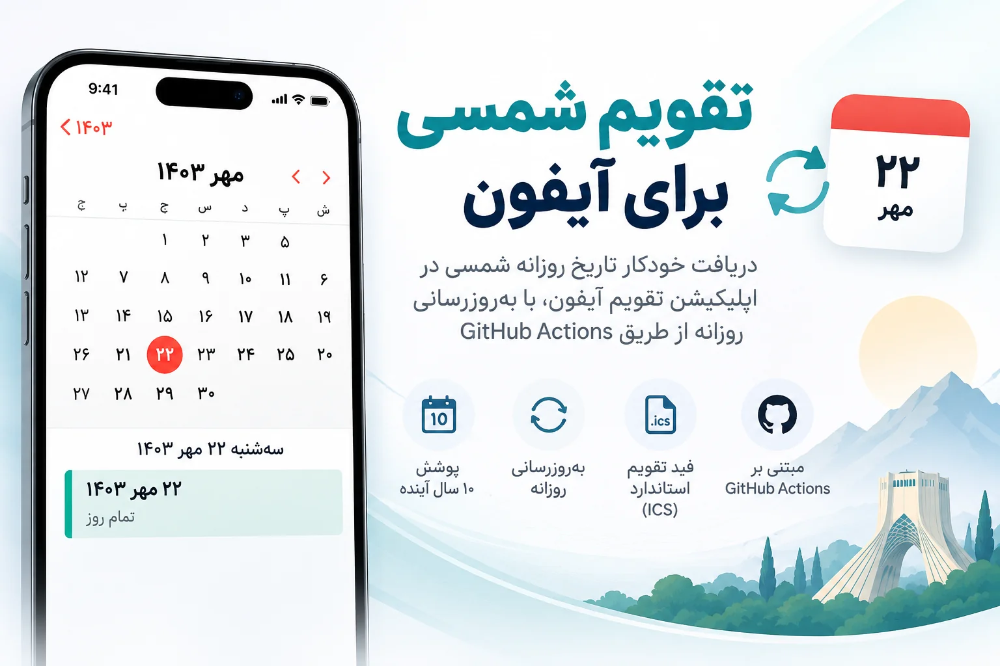
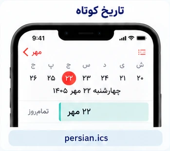
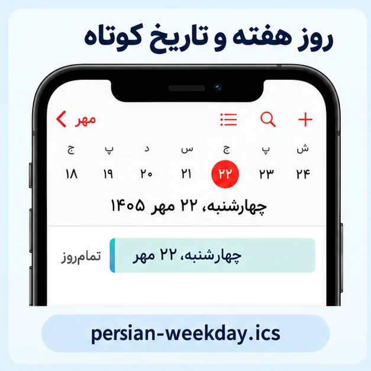
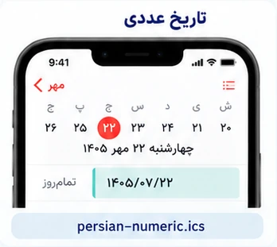
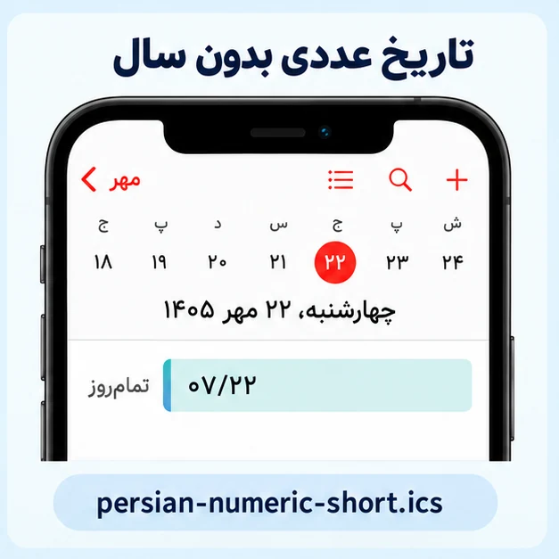
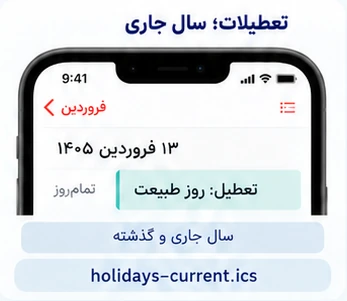
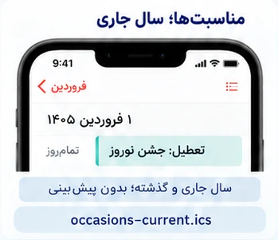
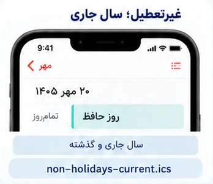
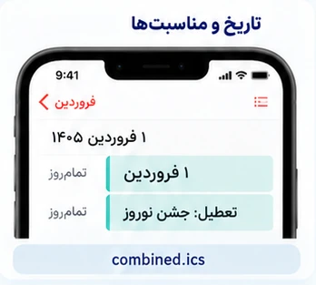
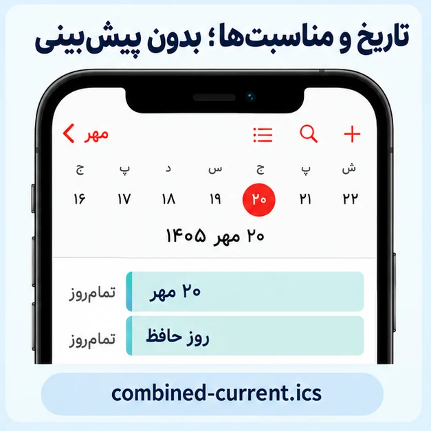

# تقویم شمسی برای آیفون

تاریخ فارسی، تعطیلات و مناسبت‌ها در Calendar آیفون؛ با لینک ثابت و به‌روزرسانی خودکار.

تاریخ روزانه و جمعه‌ها: **۱۰ سال گذشته تا ۱۰ سال آینده**؛ بازه هر روز جلو می‌رود. پوشش مناسبت‌ها و تعطیلات به دادهٔ موجود منبع وابسته است.

## شروع سریع

۱. از جدول، حالت دلخواه را انتخاب و **آدرس لینک اشتراک را کپی کن**.

۲. در آیفون برو به:

`Calendar → Calendars → Add Calendar → Add Subscription Calendar`

۳. آدرس را وارد و اشتراک را ذخیره کن. رنگ هر تقویم را می‌توانی خودت انتخاب کنی.

## همهٔ حالت‌های اشتراک

نمونهٔ متن هر حالت بالای تصویر نوشته شده است. برای دیدن تصویر اصلی، روی آن بزن.

**فقط تاریخ فارسی:** «تاریخ کوتاه». **تاریخ و تعطیلات با دو رنگ:** «تاریخ کوتاه» + «فقط تعطیلات». **همه‌چیز با یک لینک:** «تاریخ و مناسبت‌ها».

<h3>تاریخ روزانه</h3>
<table align="center">
<tbody>
<tr><th align="center">تاریخ کوتاه؛ مثل ۲۲ مهر</th></tr>
<tr><td align="center">
<strong>نمونهٔ متن:</strong> ۲۲ مهر
  <a href="https://raw.githubusercontent.com/hossbit/persian_calender/main/feeds/persian.ics"><strong>باز کردن لینک اشتراک</strong></a> persian.ics  </td></tr>
<tr><th align="center">روز هفته و تاریخ کوتاه؛ مثل چهارشنبه، ۲۲ مهر</th></tr>
<tr><td align="center">
<strong>نمونهٔ متن:</strong> چهارشنبه، ۲۲ مهر
  <a href="https://raw.githubusercontent.com/hossbit/persian_calender/main/feeds/persian-weekday.ics"><strong>باز کردن لینک اشتراک</strong></a> persian-weekday.ics  </td></tr>
<tr><th align="center">تاریخ کامل؛ روز هفته، روز، ماه و سال</th></tr>
<tr><td align="center">
<strong>نمونهٔ متن:</strong> چهارشنبه، ۲۲ مهر ۱۴۰۵
  <a href="https://raw.githubusercontent.com/hossbit/persian_calender/main/feeds/persian-full.ics"><strong>باز کردن لینک اشتراک</strong></a> persian-full.ics  </td></tr>
<tr><th align="center">تاریخ عددی فارسی؛ مثل ۱۴۰۵/۰۷/۲۲</th></tr>
<tr><td align="center">
<strong>نمونهٔ متن:</strong> ۱۴۰۵/۰۷/۲۲
  <a href="https://raw.githubusercontent.com/hossbit/persian_calender/main/feeds/persian-numeric.ics"><strong>باز کردن لینک اشتراک</strong></a> persian-numeric.ics  </td></tr>
<tr><th align="center">تاریخ عددی بدون سال؛ مثل ۰۷/۲۲</th></tr>
<tr><td align="center">
<strong>نمونهٔ متن:</strong> ۰۷/۲۲
  <a href="https://raw.githubusercontent.com/hossbit/persian_calender/main/feeds/persian-numeric-short.ics"><strong>باز کردن لینک اشتراک</strong></a> persian-numeric-short.ics  </td></tr>
</tbody>
</table>
 

<h3>تعطیلات و مناسبت‌ها</h3>
<table align="center">
<tbody>
<tr><th align="center">فقط تعطیلات مناسبتی؛ شامل پیش‌بینی آینده</th></tr>
<tr><td align="center">
<strong>نمونهٔ متن:</strong> تعطیل: جشن نوروز
  <a href="https://raw.githubusercontent.com/hossbit/persian_calender/main/feeds/holidays.ics"><strong>باز کردن لینک اشتراک</strong></a> holidays.ics  </td></tr>
<tr><th align="center">همهٔ مناسبت‌ها و تعطیلات؛ شامل پیش‌بینی آینده</th></tr>
<tr><td align="center">
<strong>نمونهٔ متن:</strong> تعطیل: جشن نوروز · پیش‌بینی: تعطیل: جشن نوروز
  <a href="https://raw.githubusercontent.com/hossbit/persian_calender/main/feeds/occasions.ics"><strong>باز کردن لینک اشتراک</strong></a> occasions.ics  </td></tr>
<tr><th align="center">فقط مناسبت‌های غیرتعطیل؛ شامل پیش‌بینی آینده</th></tr>
<tr><td align="center">
<strong>نمونهٔ متن:</strong> آغاز سال تحصیلی
  <a href="https://raw.githubusercontent.com/hossbit/persian_calender/main/feeds/non-holidays.ics"><strong>باز کردن لینک اشتراک</strong></a> non-holidays.ics  </td></tr>
<tr><th align="center">فقط تعطیلات مناسبتی؛ سال جاری و گذشته</th></tr>
<tr><td align="center">
<strong>نمونهٔ متن:</strong> تعطیل: روز طبیعت
  <a href="https://raw.githubusercontent.com/hossbit/persian_calender/main/feeds/holidays-current.ics"><strong>باز کردن لینک اشتراک</strong></a> holidays-current.ics  </td></tr>
<tr><th align="center">مناسبت‌ها و تعطیلات؛ فقط سال جاری و گذشته</th></tr>
<tr><td align="center">
<strong>نمونهٔ متن:</strong> تعطیل: جشن نوروز
  <a href="https://raw.githubusercontent.com/hossbit/persian_calender/main/feeds/occasions-current.ics"><strong>باز کردن لینک اشتراک</strong></a> occasions-current.ics  </td></tr>
<tr><th align="center">مناسبت‌های غیرتعطیل؛ سال جاری و گذشته</th></tr>
<tr><td align="center">
<strong>نمونهٔ متن:</strong> روز حافظ
  <a href="https://raw.githubusercontent.com/hossbit/persian_calender/main/feeds/non-holidays-current.ics"><strong>باز کردن لینک اشتراک</strong></a> non-holidays-current.ics  </td></tr>
<tr><th align="center">فقط جمعه‌ها</th></tr>
<tr><td align="center">
<strong>نمونهٔ متن:</strong> جمعه
  <a href="https://raw.githubusercontent.com/hossbit/persian_calender/main/feeds/fridays.ics"><strong>باز کردن لینک اشتراک</strong></a> fridays.ics  </td></tr>
<tr><th align="center">تعطیلات مناسبتی به‌همراه جمعه‌ها؛ شامل پیش‌بینی آینده</th></tr>
<tr><td align="center">
<strong>نمونهٔ متن:</strong> تعطیل: روز طبیعت · جمعه
  <a href="https://raw.githubusercontent.com/hossbit/persian_calender/main/feeds/holidays-with-fridays.ics"><strong>باز کردن لینک اشتراک</strong></a> holidays-with-fridays.ics  </td></tr>
</tbody>
</table>
 

<h3>ترکیبی؛ چند قابلیت با یک لینک</h3>
<table align="center">
<tbody>
<tr><th align="center">تاریخ کوتاه و فقط تعطیلات در یک اشتراک</th></tr>
<tr><td align="center">
<strong>نمونهٔ متن:</strong> ۱ فروردین + تعطیل: جشن نوروز
  <a href="https://raw.githubusercontent.com/hossbit/persian_calender/main/feeds/dates-holidays.ics"><strong>باز کردن لینک اشتراک</strong></a> dates-holidays.ics  </td></tr>
<tr><th align="center">تاریخ کوتاه و همهٔ مناسبت‌ها در یک اشتراک</th></tr>
<tr><td align="center">
<strong>نمونهٔ متن:</strong> ۱ فروردین + تعطیل: جشن نوروز
  <a href="https://raw.githubusercontent.com/hossbit/persian_calender/main/feeds/combined.ics"><strong>باز کردن لینک اشتراک</strong></a> combined.ics  </td></tr>
<tr><th align="center">تاریخ کوتاه و مناسبت‌ها؛ بدون پیش‌بینی سال‌های آینده</th></tr>
<tr><td align="center">
<strong>نمونهٔ متن:</strong> ۲۰ مهر + روز حافظ
  <a href="https://raw.githubusercontent.com/hossbit/persian_calender/main/feeds/combined-current.ics"><strong>باز کردن لینک اشتراک</strong></a> combined-current.ics  </td></tr>
</tbody>
</table>
 

فقط حالت‌های لازم را اضافه کن؛ لینک‌های هم‌پوشان ممکن است رویداد تکراری نشان بدهند. نسخهٔ ترکیبی را همراه تاریخ کوتاه یا همهٔ مناسبت‌ها اضافه نکن.

تصاویر شبیه‌سازی‌اند. تاریخ‌ها به شکل رویداد تمام‌روز نمایش داده می‌شوند؛ چیدمان ماه‌های خود Calendar تغییر نمی‌کند. مناسبت‌های آینده با «پیش‌بینی» مشخص‌اند و پوشش آن‌ها به دادهٔ موجود منبع وابسته است.

[جزئیات فنی و منابع](TECHNICAL.md) · [راهنمای کامل حالت‌ها](SUBSCRIPTIONS.md)
