## راهنمای همهٔ لینک‌های اشتراک

همهٔ فایل‌ها روزانه بازتولید می‌شوند و لینک‌ها ثابت‌اند. تصاویر، شبیه‌سازی نمایشی هستند؛ ظاهر واقعی تابع نسخه و تنظیمات iOS است. برای دیدن هر تصویر در اندازهٔ کامل، روی آن کلیک کنید.

<h3>تاریخ روزانه</h3>
<table align="center">
<tbody>
<tr>
<td align="center" valign="top"><strong>تاریخ کوتاه؛ مثل ۲۲ مهر</strong> 
۲۲ مهر
<a href="assets/previews/persian-frameless.webp">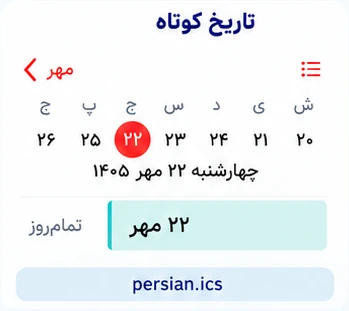</a> <a href="https://raw.githubusercontent.com/hossbit/persian_calender/main/feeds/persian.ics"><strong>لینک اشتراک</strong></a></td>
<td align="center" valign="top"><strong>روز هفته و تاریخ کوتاه؛ مثل چهارشنبه، ۲۲ مهر</strong> 
چهارشنبه، ۲۲ مهر
<a href="assets/previews/persian-weekday-frameless.webp">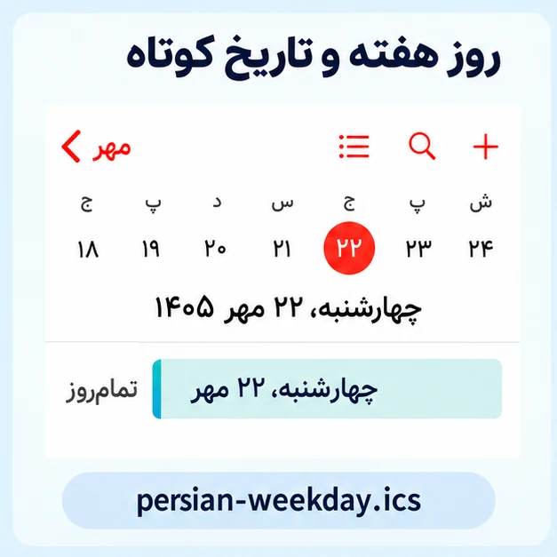</a> <a href="https://raw.githubusercontent.com/hossbit/persian_calender/main/feeds/persian-weekday.ics"><strong>لینک اشتراک</strong></a></td>
</tr>
<tr>
<td align="center" valign="top"><strong>تاریخ کامل؛ روز هفته، روز، ماه و سال</strong> 
چهارشنبه، ۲۲ مهر ۱۴۰۵
<a href="assets/previews/persian-full-frameless.webp">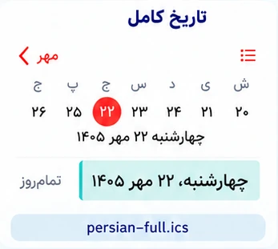</a> <a href="https://raw.githubusercontent.com/hossbit/persian_calender/main/feeds/persian-full.ics"><strong>لینک اشتراک</strong></a></td>
<td align="center" valign="top"><strong>تاریخ عددی فارسی؛ مثل ۱۴۰۵/۰۷/۲۲</strong> 
۱۴۰۵/۰۷/۲۲
<a href="assets/previews/persian-numeric-frameless.webp">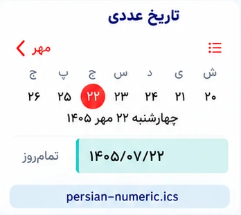</a> <a href="https://raw.githubusercontent.com/hossbit/persian_calender/main/feeds/persian-numeric.ics"><strong>لینک اشتراک</strong></a></td>
</tr>
<tr>
<td align="center" valign="top"><strong>تاریخ عددی بدون سال؛ مثل ۰۷/۲۲</strong> 
۰۷/۲۲
<a href="assets/previews/persian-numeric-short-frameless.webp">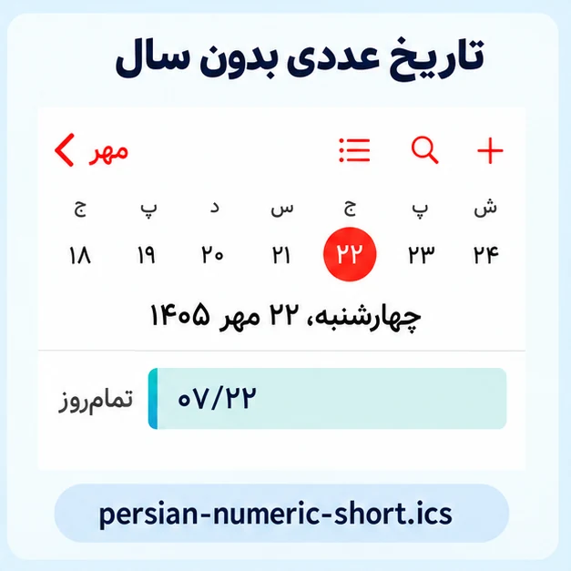</a> <a href="https://raw.githubusercontent.com/hossbit/persian_calender/main/feeds/persian-numeric-short.ics"><strong>لینک اشتراک</strong></a></td>
<td></td>
</tr>
</tbody>
</table>

<h3>تعطیلات و مناسبت‌ها</h3>
<table align="center">
<tbody>
<tr>
<td align="center" valign="top"><strong>فقط تعطیلات مناسبتی؛ شامل پیش‌بینی آینده</strong> 
تعطیل: جشن نوروز
<a href="assets/previews/holidays-frameless.webp">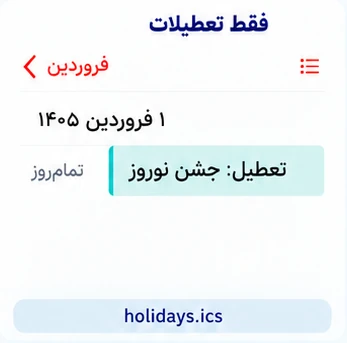</a> <a href="https://raw.githubusercontent.com/hossbit/persian_calender/main/feeds/holidays.ics"><strong>لینک اشتراک</strong></a></td>
<td align="center" valign="top"><strong>همهٔ مناسبت‌ها و تعطیلات؛ شامل پیش‌بینی آینده</strong> 
تعطیل: جشن نوروز · پیش‌بینی: تعطیل: جشن نوروز
<a href="assets/previews/occasions-frameless.webp">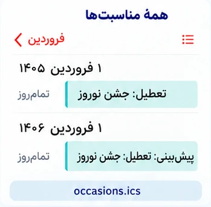</a> <a href="https://raw.githubusercontent.com/hossbit/persian_calender/main/feeds/occasions.ics"><strong>لینک اشتراک</strong></a></td>
</tr>
<tr>
<td align="center" valign="top"><strong>فقط مناسبت‌های غیرتعطیل؛ شامل پیش‌بینی آینده</strong> 
آغاز سال تحصیلی
 <a href="https://raw.githubusercontent.com/hossbit/persian_calender/main/feeds/non-holidays.ics"><strong>لینک اشتراک</strong></a></td>
<td align="center" valign="top"><strong>فقط تعطیلات مناسبتی؛ سال جاری و گذشته</strong> 
تعطیل: روز طبیعت
<a href="assets/previews/holidays-current-frameless.webp">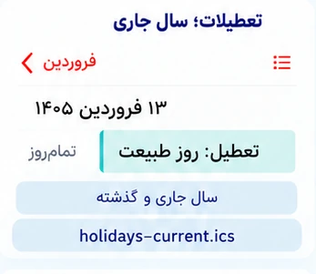</a> <a href="https://raw.githubusercontent.com/hossbit/persian_calender/main/feeds/holidays-current.ics"><strong>لینک اشتراک</strong></a></td>
</tr>
<tr>
<td align="center" valign="top"><strong>مناسبت‌ها و تعطیلات؛ فقط سال جاری و گذشته</strong> 
تعطیل: جشن نوروز
<a href="assets/previews/occasions-current-frameless.webp">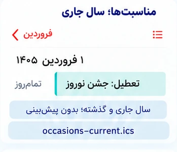</a> <a href="https://raw.githubusercontent.com/hossbit/persian_calender/main/feeds/occasions-current.ics"><strong>لینک اشتراک</strong></a></td>
<td align="center" valign="top"><strong>مناسبت‌های غیرتعطیل؛ سال جاری و گذشته</strong> 
روز حافظ
<a href="assets/previews/non-holidays-current-frameless.webp">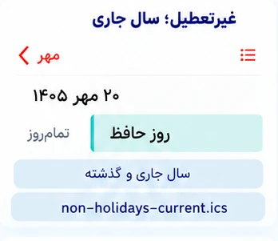</a> <a href="https://raw.githubusercontent.com/hossbit/persian_calender/main/feeds/non-holidays-current.ics"><strong>لینک اشتراک</strong></a></td>
</tr>
<tr>
<td align="center" valign="top"><strong>فقط جمعه‌ها</strong> 
جمعه
<a href="assets/previews/fridays-frameless.webp">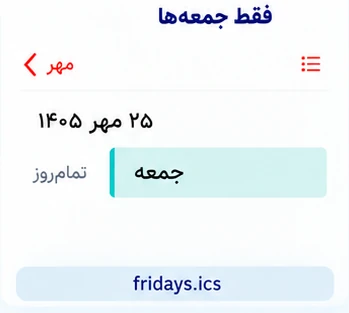</a> <a href="https://raw.githubusercontent.com/hossbit/persian_calender/main/feeds/fridays.ics"><strong>لینک اشتراک</strong></a></td>
<td align="center" valign="top"><strong>تعطیلات مناسبتی به‌همراه جمعه‌ها؛ شامل پیش‌بینی آینده</strong> 
تعطیل: روز طبیعت · جمعه
<a href="assets/previews/holidays-with-fridays-frameless.webp">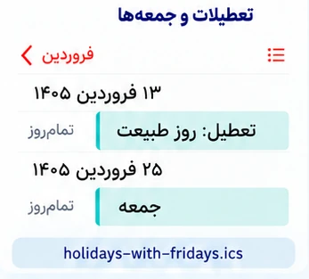</a> <a href="https://raw.githubusercontent.com/hossbit/persian_calender/main/feeds/holidays-with-fridays.ics"><strong>لینک اشتراک</strong></a></td>
</tr>
</tbody>
</table>

<h3>حالت‌های ترکیبی</h3>
<table align="center">
<tbody>
<tr>
<td align="center" valign="top"><strong>تاریخ کوتاه و فقط تعطیلات در یک اشتراک</strong> 
۱ فروردین + تعطیل: جشن نوروز
<a href="assets/previews/dates-holidays-frameless.webp">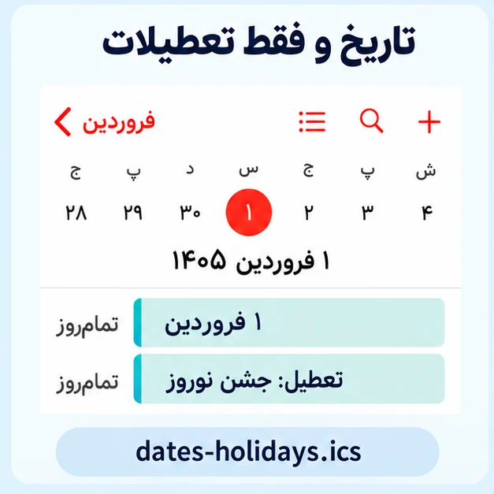</a> <a href="https://raw.githubusercontent.com/hossbit/persian_calender/main/feeds/dates-holidays.ics"><strong>لینک اشتراک</strong></a></td>
<td align="center" valign="top"><strong>تاریخ کوتاه و همهٔ مناسبت‌ها در یک اشتراک</strong> 
۱ فروردین + تعطیل: جشن نوروز
<a href="assets/previews/combined-frameless.webp">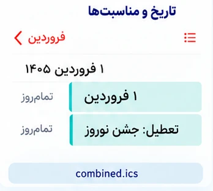</a> <a href="https://raw.githubusercontent.com/hossbit/persian_calender/main/feeds/combined.ics"><strong>لینک اشتراک</strong></a></td>
</tr>
<tr>
<td align="center" valign="top"><strong>تاریخ کوتاه و مناسبت‌ها؛ بدون پیش‌بینی سال‌های آینده</strong> 
۲۰ مهر + روز حافظ
<a href="assets/previews/combined-current-frameless.webp">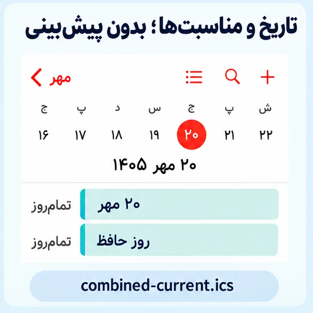</a> <a href="https://raw.githubusercontent.com/hossbit/persian_calender/main/feeds/combined-current.ics"><strong>لینک اشتراک</strong></a></td>
<td></td>
</tr>
</tbody>
</table>

### انتخاب پیشنهادی

برای کنترل رنگ جداگانه: تاریخ کوتاه + فقط تعطیلات، یا تاریخ کوتاه + همهٔ مناسبت‌ها. برای یک لینک: نسخهٔ ترکیبی.

نسخه‌های تاریخ کوتاه، کامل و عددی جایگزین یکدیگرند. نسخهٔ ترکیبی همان رویدادهای تاریخ کوتاه و مناسبت‌ها را دارد؛ همراه آن این دو را جدا اضافه نکنید. «همهٔ مناسبت‌ها» تعطیلات را نیز دارد؛ هم‌زمان افزودن فیدهای هم‌پوشان باعث تکرار یا شلوغی می‌شود. رنگ هر اشتراک در آیفون جدا قابل انتخاب است؛ نسخهٔ ترکیبی یک رنگ مشترک دارد.

نسخه‌های سال جاری و گذشته هر روز سال جاری شمسی را تشخیص می‌دهند؛ با ورود به سال جدید دادهٔ آن سال نیز اضافه می‌شود، در صورت موجودبودن در منبع. حذف پیش‌بینی به معنای تأیید رسمی داده‌ها نیست. تعطیلی اضطراری یا محلی تضمین نمی‌شود. مناسبت‌ها فقط تا جایی که منبع داده منتشر کرده پوشش دارند؛ تاریخ‌های روزانه و جمعه‌ها ده سال آینده را محاسبه می‌کنند. جمعه‌ها بر اساس تاریخ روزِ نمایش‌داده‌شدهٔ دستگاه هستند.
