## راهنمای همهٔ لینک‌های اشتراک

همهٔ فایل‌ها روزانه بازتولید می‌شوند و لینک‌ها ثابت‌اند. تصاویر، شبیه‌سازی نمایشی هستند؛ ظاهر واقعی تابع نسخه و تنظیمات iOS است. برای دیدن هر تصویر در اندازهٔ کامل، روی آن کلیک کنید.

<h3>تاریخ روزانه</h3>
<table align="center">
<tbody>
<tr>
<td align="center" valign="middle"><strong>تاریخ کوتاه؛ مثل ۲۲ مهر</strong></td>
<td align="center" valign="middle"><strong>روز هفته و تاریخ کوتاه؛ مثل چهارشنبه، ۲۲ مهر</strong></td>
</tr>
<tr>
<td align="center" valign="middle">
۲۲ مهر
</td>
<td align="center" valign="middle">
چهارشنبه، ۲۲ مهر
</td>
</tr>
<tr>
<td align="center" valign="middle"><table align="center"><tbody><tr><td align="center" width="260"><a href="assets/previews/persian-uniform.webp">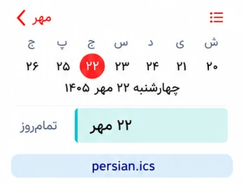</a></td></tr></tbody></table></td>
<td align="center" valign="middle"><table align="center"><tbody><tr><td align="center" width="260"><a href="assets/previews/persian-weekday-uniform.webp">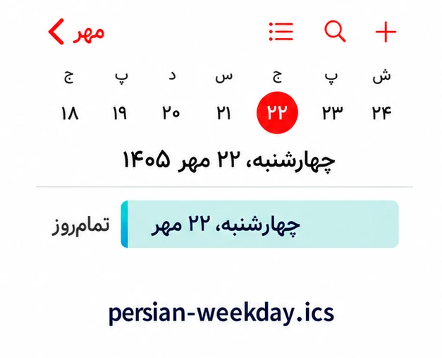</a></td></tr></tbody></table></td>
</tr>
<tr>
<td align="center" valign="middle"><a href="https://raw.githubusercontent.com/hossbit/persian_calender/main/feeds/persian.ics"><strong>لینک اشتراک</strong></a></td>
<td align="center" valign="middle"><a href="https://raw.githubusercontent.com/hossbit/persian_calender/main/feeds/persian-weekday.ics"><strong>لینک اشتراک</strong></a></td>
</tr>
<tr>
<td align="center" valign="middle"><strong>تاریخ کامل؛ روز هفته، روز، ماه و سال</strong></td>
<td align="center" valign="middle"><strong>تاریخ عددی فارسی؛ مثل ۱۴۰۵/۰۷/۲۲</strong></td>
</tr>
<tr>
<td align="center" valign="middle">
چهارشنبه، ۲۲ مهر ۱۴۰۵
</td>
<td align="center" valign="middle">
۱۴۰۵/۰۷/۲۲
</td>
</tr>
<tr>
<td align="center" valign="middle"><table align="center"><tbody><tr><td align="center" width="260"><a href="assets/previews/persian-full-uniform.webp">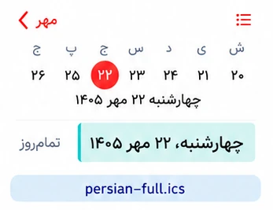</a></td></tr></tbody></table></td>
<td align="center" valign="middle"><table align="center"><tbody><tr><td align="center" width="260"><a href="assets/previews/persian-numeric-uniform.webp">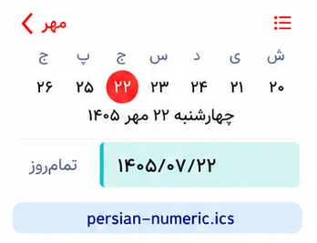</a></td></tr></tbody></table></td>
</tr>
<tr>
<td align="center" valign="middle"><a href="https://raw.githubusercontent.com/hossbit/persian_calender/main/feeds/persian-full.ics"><strong>لینک اشتراک</strong></a></td>
<td align="center" valign="middle"><a href="https://raw.githubusercontent.com/hossbit/persian_calender/main/feeds/persian-numeric.ics"><strong>لینک اشتراک</strong></a></td>
</tr>
<tr>
<td colspan="2" align="center" valign="middle"><strong>تاریخ عددی بدون سال؛ مثل ۰۷/۲۲</strong></td>
</tr>
<tr>
<td colspan="2" align="center" valign="middle">
۰۷/۲۲
</td>
</tr>
<tr>
<td colspan="2" align="center" valign="middle"><table align="center"><tbody><tr><td align="center" width="260"><a href="assets/previews/persian-numeric-short-uniform.webp">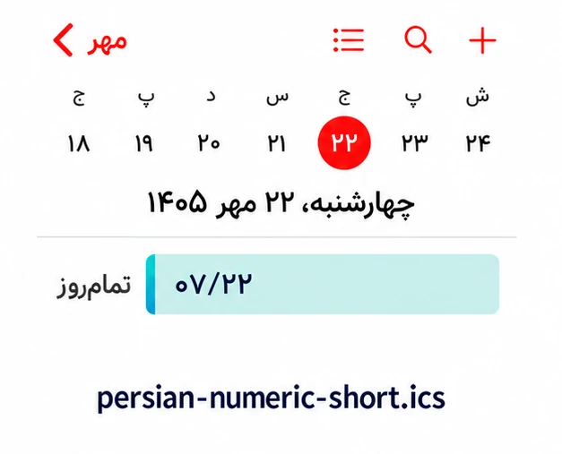</a></td></tr></tbody></table></td>
</tr>
<tr>
<td colspan="2" align="center" valign="middle"><a href="https://raw.githubusercontent.com/hossbit/persian_calender/main/feeds/persian-numeric-short.ics"><strong>لینک اشتراک</strong></a></td>
</tr>
</tbody>
</table>

<h3>تعطیلات و مناسبت‌ها</h3>
<table align="center">
<tbody>
<tr>
<td align="center" valign="middle"><strong>فقط تعطیلات مناسبتی؛ شامل پیش‌بینی آینده</strong></td>
<td align="center" valign="middle"><strong>همهٔ مناسبت‌ها و تعطیلات؛ شامل پیش‌بینی آینده</strong></td>
</tr>
<tr>
<td align="center" valign="middle">
تعطیل: جشن نوروز
</td>
<td align="center" valign="middle">
تعطیل: جشن نوروز · پیش‌بینی: تعطیل: جشن نوروز
</td>
</tr>
<tr>
<td align="center" valign="middle"><table align="center"><tbody><tr><td align="center" width="260"><a href="assets/previews/holidays-uniform.webp">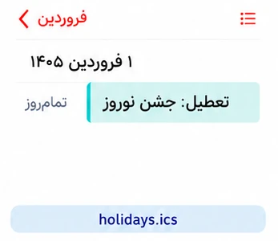</a></td></tr></tbody></table></td>
<td align="center" valign="middle"><table align="center"><tbody><tr><td align="center" width="260"><a href="assets/previews/occasions-uniform.webp">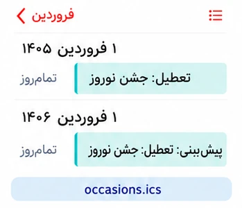</a></td></tr></tbody></table></td>
</tr>
<tr>
<td align="center" valign="middle"><a href="https://raw.githubusercontent.com/hossbit/persian_calender/main/feeds/holidays.ics"><strong>لینک اشتراک</strong></a></td>
<td align="center" valign="middle"><a href="https://raw.githubusercontent.com/hossbit/persian_calender/main/feeds/occasions.ics"><strong>لینک اشتراک</strong></a></td>
</tr>
<tr>
<td align="center" valign="middle"><strong>فقط مناسبت‌های غیرتعطیل؛ شامل پیش‌بینی آینده</strong></td>
<td align="center" valign="middle"><strong>فقط تعطیلات مناسبتی؛ سال جاری و گذشته</strong></td>
</tr>
<tr>
<td align="center" valign="middle">
آغاز سال تحصیلی
</td>
<td align="center" valign="middle">
تعطیل: روز طبیعت
</td>
</tr>
<tr>
<td align="center" valign="middle"><table align="center"><tbody><tr><td align="center" width="260"><a href="assets/previews/non-holidays-uniform.webp">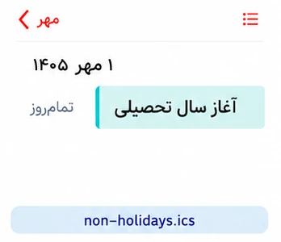</a></td></tr></tbody></table></td>
<td align="center" valign="middle"><table align="center"><tbody><tr><td align="center" width="260"><a href="assets/previews/holidays-current-uniform.webp">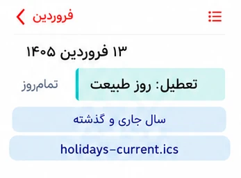</a></td></tr></tbody></table></td>
</tr>
<tr>
<td align="center" valign="middle"><a href="https://raw.githubusercontent.com/hossbit/persian_calender/main/feeds/non-holidays.ics"><strong>لینک اشتراک</strong></a></td>
<td align="center" valign="middle"><a href="https://raw.githubusercontent.com/hossbit/persian_calender/main/feeds/holidays-current.ics"><strong>لینک اشتراک</strong></a></td>
</tr>
<tr>
<td align="center" valign="middle"><strong>مناسبت‌ها و تعطیلات؛ فقط سال جاری و گذشته</strong></td>
<td align="center" valign="middle"><strong>مناسبت‌های غیرتعطیل؛ سال جاری و گذشته</strong></td>
</tr>
<tr>
<td align="center" valign="middle">
تعطیل: جشن نوروز
</td>
<td align="center" valign="middle">
روز حافظ
</td>
</tr>
<tr>
<td align="center" valign="middle"><table align="center"><tbody><tr><td align="center" width="260"><a href="assets/previews/occasions-current-uniform.webp">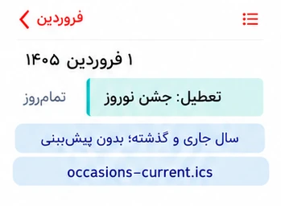</a></td></tr></tbody></table></td>
<td align="center" valign="middle"><table align="center"><tbody><tr><td align="center" width="260"><a href="assets/previews/non-holidays-current-uniform.webp">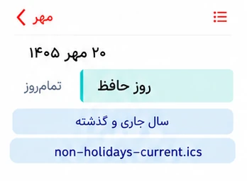</a></td></tr></tbody></table></td>
</tr>
<tr>
<td align="center" valign="middle"><a href="https://raw.githubusercontent.com/hossbit/persian_calender/main/feeds/occasions-current.ics"><strong>لینک اشتراک</strong></a></td>
<td align="center" valign="middle"><a href="https://raw.githubusercontent.com/hossbit/persian_calender/main/feeds/non-holidays-current.ics"><strong>لینک اشتراک</strong></a></td>
</tr>
<tr>
<td align="center" valign="middle"><strong>فقط جمعه‌ها</strong></td>
<td align="center" valign="middle"><strong>تعطیلات مناسبتی به‌همراه جمعه‌ها؛ شامل پیش‌بینی آینده</strong></td>
</tr>
<tr>
<td align="center" valign="middle">
جمعه
</td>
<td align="center" valign="middle">
تعطیل: روز طبیعت · جمعه
</td>
</tr>
<tr>
<td align="center" valign="middle"><table align="center"><tbody><tr><td align="center" width="260"><a href="assets/previews/fridays-uniform.webp">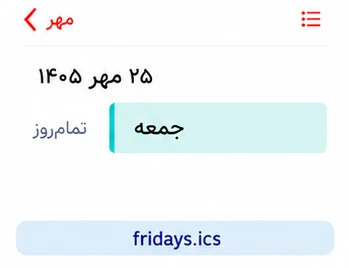</a></td></tr></tbody></table></td>
<td align="center" valign="middle"><table align="center"><tbody><tr><td align="center" width="260"><a href="assets/previews/holidays-with-fridays-uniform.webp">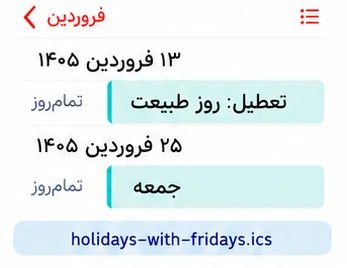</a></td></tr></tbody></table></td>
</tr>
<tr>
<td align="center" valign="middle"><a href="https://raw.githubusercontent.com/hossbit/persian_calender/main/feeds/fridays.ics"><strong>لینک اشتراک</strong></a></td>
<td align="center" valign="middle"><a href="https://raw.githubusercontent.com/hossbit/persian_calender/main/feeds/holidays-with-fridays.ics"><strong>لینک اشتراک</strong></a></td>
</tr>
</tbody>
</table>

<h3>حالت‌های ترکیبی</h3>
<table align="center">
<tbody>
<tr>
<td align="center" valign="middle"><strong>تاریخ کوتاه و فقط تعطیلات در یک اشتراک</strong></td>
<td align="center" valign="middle"><strong>تاریخ کوتاه و همهٔ مناسبت‌ها در یک اشتراک</strong></td>
</tr>
<tr>
<td align="center" valign="middle">
۱ فروردین + تعطیل: جشن نوروز
</td>
<td align="center" valign="middle">
۱ فروردین + تعطیل: جشن نوروز
</td>
</tr>
<tr>
<td align="center" valign="middle"><table align="center"><tbody><tr><td align="center" width="260"><a href="assets/previews/dates-holidays-uniform.webp">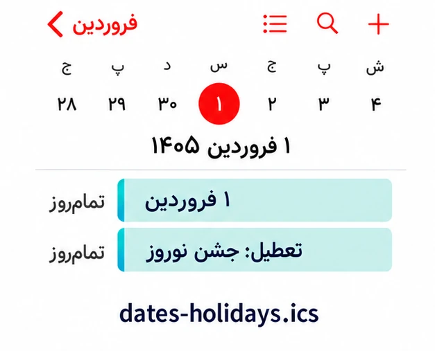</a></td></tr></tbody></table></td>
<td align="center" valign="middle"><table align="center"><tbody><tr><td align="center" width="260"><a href="assets/previews/combined-uniform.webp">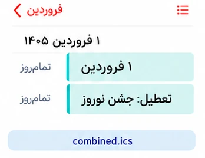</a></td></tr></tbody></table></td>
</tr>
<tr>
<td align="center" valign="middle"><a href="https://raw.githubusercontent.com/hossbit/persian_calender/main/feeds/dates-holidays.ics"><strong>لینک اشتراک</strong></a></td>
<td align="center" valign="middle"><a href="https://raw.githubusercontent.com/hossbit/persian_calender/main/feeds/combined.ics"><strong>لینک اشتراک</strong></a></td>
</tr>
<tr>
<td colspan="2" align="center" valign="middle"><strong>تاریخ کوتاه و مناسبت‌ها؛ بدون پیش‌بینی سال‌های آینده</strong></td>
</tr>
<tr>
<td colspan="2" align="center" valign="middle">
۲۰ مهر + روز حافظ
</td>
</tr>
<tr>
<td colspan="2" align="center" valign="middle"><table align="center"><tbody><tr><td align="center" width="260"><a href="assets/previews/combined-current-uniform.webp">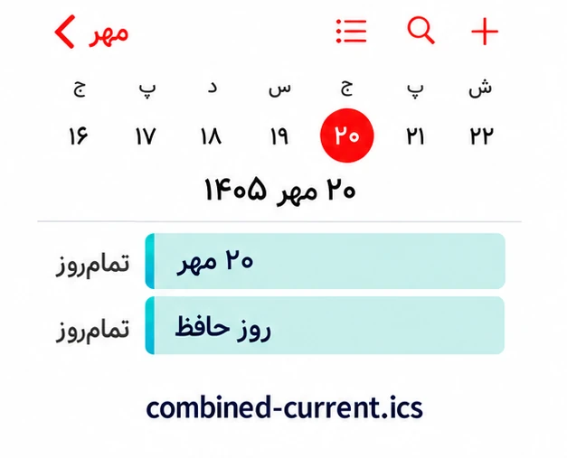</a></td></tr></tbody></table></td>
</tr>
<tr>
<td colspan="2" align="center" valign="middle"><a href="https://raw.githubusercontent.com/hossbit/persian_calender/main/feeds/combined-current.ics"><strong>لینک اشتراک</strong></a></td>
</tr>
</tbody>
</table>

### انتخاب پیشنهادی

برای کنترل رنگ جداگانه: تاریخ کوتاه + فقط تعطیلات، یا تاریخ کوتاه + همهٔ مناسبت‌ها. برای یک لینک: نسخهٔ ترکیبی.

نسخه‌های تاریخ کوتاه، کامل و عددی جایگزین یکدیگرند. نسخهٔ ترکیبی همان رویدادهای تاریخ کوتاه و مناسبت‌ها را دارد؛ همراه آن این دو را جدا اضافه نکنید. «همهٔ مناسبت‌ها» تعطیلات را نیز دارد؛ هم‌زمان افزودن فیدهای هم‌پوشان باعث تکرار یا شلوغی می‌شود. رنگ هر اشتراک در آیفون جدا قابل انتخاب است؛ نسخهٔ ترکیبی یک رنگ مشترک دارد.

نسخه‌های سال جاری و گذشته هر روز سال جاری شمسی را تشخیص می‌دهند؛ با ورود به سال جدید دادهٔ آن سال نیز اضافه می‌شود، در صورت موجودبودن در منبع. حذف پیش‌بینی به معنای تأیید رسمی داده‌ها نیست. تعطیلی اضطراری یا محلی تضمین نمی‌شود. مناسبت‌ها فقط تا جایی که منبع داده منتشر کرده پوشش دارند؛ تاریخ‌های روزانه و جمعه‌ها ده سال آینده را محاسبه می‌کنند. جمعه‌ها بر اساس تاریخ روزِ نمایش‌داده‌شدهٔ دستگاه هستند.
